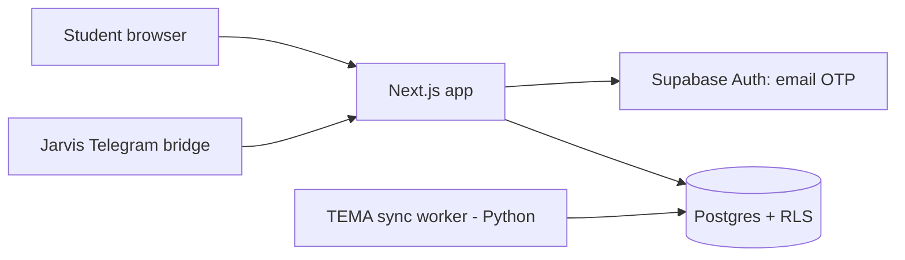

# UNAB OS (Universidad OS)

A Next.js workspace for university life: subjects, tasks, academic collaboration between students (sections, memberships) and a Jarvis bridge for Telegram. Auth is passwordless (email OTP) restricted server-side to institutional domains; data lives in Supabase Postgres with row-level policies and SQL tests.

**Stack:** Next.js (App Router), React, TypeScript, Supabase (Auth, Postgres, RLS), Vitest, Playwright, Python sync workers, Docker/Railway/Netlify configs.



## Structure
`UNAB_OS_Plataforma/app` routes - `components/uninova` UI - `lib/supabase` - `supabase/` migrations + pgTAP-style tests - `tests/` domain, integration, e2e, python - `docs/` design and handoff notes.

## Run
```bash
cd UNAB_OS_Plataforma
npm ci
cp .env.example .env.local     # use your own Supabase project URL + publishable key
npm run dev                    # http://localhost:3000
npm test && npm run typecheck
```

## Status
🟡 Academic beta, single developer. Real user emails in fixtures were replaced with placeholders; the Supabase project reference was removed, so you must bring your own project. Tests were not re-run in this copy. Subscription model notes in `Modelo de Suscripción UNAB OS.md` are a proposal, not a live product.

## Consolidation note
This repo was compared file by file (blob hashes) against the private `universidad-os` source. The public tree already contains everything newer from it: the private repo's last commit predates this tree, and it holds no source, test or doc file missing here. Private history, local tool configs and personal data were intentionally not imported. Test fixtures that had been sanitized into non-institutional placeholder emails were repaired so the suite matches the `@unab.edu.co` domain rule (`student@unab.edu.co` is a placeholder).

Verified on 2026-10-30: `npm ci`, `vitest run` (55 files, 283 passed, 1 skipped) and `tsc --noEmit` pass. Not verified: Playwright e2e, `test:db` (needs local Supabase), Python workers, and any live Supabase/Telegram/Railway deployment.

## Folder guide

| Folder | What it holds |
|---|---|
| [UNAB_OS_Plataforma/](UNAB_OS_Plataforma/README.md) | The Next.js application, Supabase schema, sync workers and mobile app |
| [docs/](docs/README.md) | Study-platform brief and handoff notes |

---

Built by Monoga · [github.com/Monoga2025](https://github.com/Monoga2025)
